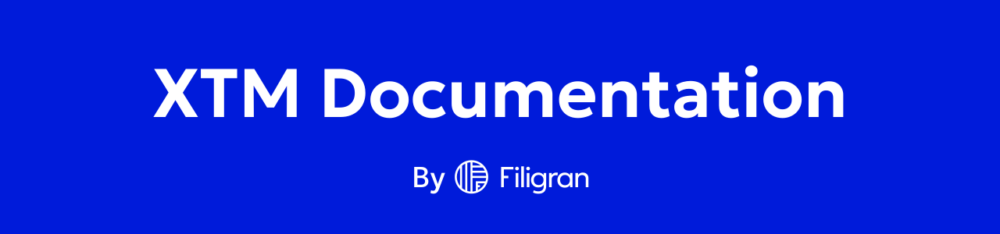

  
  
  

<b>The content of the XTM documentation: XTM One, OpenCTI, OpenAEV, OpenCRQ, XTM Hub and XTM Composer, in one place.</b>

This repository holds the content of the XTM documentation, published at **[filigran.io/docs](https://filigran.io/docs/)**: the pages, their structure and the reference data of each documented version, read from the products' code. Read the documentation on the site; come here to see its sources or to tell us what to fix.

## Table of contents

- [What it documents](#what-it-documents)
- [Where to read it](#where-to-read-it)
- [How the repository is organised](#how-the-repository-is-organised)
- [A mirror, one way](#a-mirror-one-way)
- [Tell us what to fix](#tell-us-what-to-fix)
- [Community](#community)
- [Security](#security)
- [About Filigran](#about-filigran)

## What it documents

The XTM Platform, the open platform for Agentic CTEM. Each product owns stages of the CTEM loop; XTM One runs the loop across them. The documentation is organised the same way: one part per product, and journeys that go across them.

<picture>
  <source media="(prefers-color-scheme: dark)" srcset="./.github/img/readme/xtm-platform-ctem-dark.svg">
  <source media="(prefers-color-scheme: light)" srcset="./.github/img/readme/xtm-platform-ctem-light.svg">
  
</picture>

| | Product | Role in CTEM | Product repository |
|---|---|---|---|
| <picture><source media="(prefers-color-scheme: dark)" srcset="./.github/img/readme/mark-xtm-one-dark.svg"></picture> | **XTM One** | Core and agentic layer: runs CTEM across the modules and gets the fix done | [XTM-One-Platform/xtm-one](https://github.com/XTM-One-Platform/xtm-one) |
| <picture><source media="(prefers-color-scheme: dark)" srcset="./.github/img/readme/mark-opencti-dark.svg"></picture> | **OpenCTI** | Scoping and Discovery: know the adversary and the threats that target you | [OpenCTI-Platform/opencti](https://github.com/OpenCTI-Platform/opencti) |
| <picture><source media="(prefers-color-scheme: dark)" srcset="./.github/img/readme/mark-opencrq-dark.svg"></picture> | **OpenCRQ** | Prioritization: turn exposure into financial risk | not public |
| <picture><source media="(prefers-color-scheme: dark)" srcset="./.github/img/readme/mark-openaev-dark.svg"></picture> | **OpenAEV** | Validation: prove your defenses against real attacker techniques | [OpenAEV-Platform/openaev](https://github.com/OpenAEV-Platform/openaev) |
| <picture><source media="(prefers-color-scheme: dark)" srcset="./.github/img/readme/mark-xtm-hub-dark.svg"></picture> | **XTM Hub** | Tradecraft library and gateway: integrations, dashboards and scenarios for every product | [XTM-Hub/xtm-hub](https://github.com/XTM-Hub/xtm-hub) |
| | **XTM Composer** | Runs the connectors, collectors and injectors of OpenCTI and OpenAEV as containers | [FiligranHQ/xtm-composer](https://github.com/FiligranHQ/xtm-composer) |

## Where to read it

On **[filigran.io/docs](https://filigran.io/docs/)**: every page, for every documented version, with search, the journeys across the products and the reference of each version. The files here are the sources of those pages; the site is the way to read them.

From your AI assistant: the documentation's MCP server, `https://filigran.io/docs/mcp/`, lets Claude, ChatGPT, Cursor, VS Code or XTM One answer from the published pages, for the version you run, with a link to each section. No account, no key: **[connect your assistant](https://filigran.io/docs/develop/apis/docs-mcp/)**. The Markdown here is not the right source for an assistant: its directives are not resolved and its versions are mixed, where the server gives each page as the site publishes it, at one version.

## How the repository is organised

| Folder | What it holds |
| --- | --- |
| `docs/content/` | The pages, in Markdown, with the site's structure (`versions.yml`, `suite.yml`, `journeys.yml`) |
| `docs/generated/` | The reference data of each documented version, read from the products' code: configuration keys, capabilities, APIs, data model |
| `docs/static/` | The site's static files |

## A mirror, one way

This repository is written only by Filigran's documentation pipeline: each time the documentation is published, its `main` branch receives the new content. Its other branches are drafts the documentation team is reviewing. Nothing written here directly reaches the site, so **pull requests here cannot be merged**: they are closed automatically.

## Tell us what to fix

Contributions come as issues, not pull requests:

- **On any page** of [filigran.io/docs](https://filigran.io/docs/): **Give us feedback**, or select a passage and click **Report an issue**. Either opens an issue here, filled with the page, its version and the passage.
- **Here**: [open an issue](https://github.com/FiligranHQ/xtm-docs/issues/new/choose).

The documentation team reads every issue. When it takes one on, the change is written, reviewed and published, and the issue is closed with it. The [contributing guide](CONTRIBUTING.md) says what makes an issue easy to act on.

## Community

- **Questions about using a product**: the Filigran [community Slack](https://community.filigran.io).
- **A mistake or a gap in the documentation**: [issues of this repository](https://github.com/FiligranHQ/xtm-docs/issues).
- **A bug or a feature request of a product**: its own repository, [XTM One](https://github.com/XTM-One-Platform/xtm-one/issues), [OpenCTI](https://github.com/OpenCTI-Platform/opencti/issues), [OpenAEV](https://github.com/OpenAEV-Platform/openaev/issues), [XTM Composer](https://github.com/FiligranHQ/xtm-composer/issues).

## Security

A security vulnerability in a product is never an issue here: issues are public. See [SECURITY.md](SECURITY.md) for where to report it privately.

## About Filigran

The XTM Platform and its documentation are designed and developed by [Filigran](https://filigran.io), the company behind the XTM Platform for Agentic CTEM.

<picture>
  <source media="(prefers-color-scheme: dark)" srcset="./.github/img/readme/filigran-dark.svg">
  <source media="(prefers-color-scheme: light)" srcset="./.github/img/readme/filigran-light.svg">
  
</picture>
